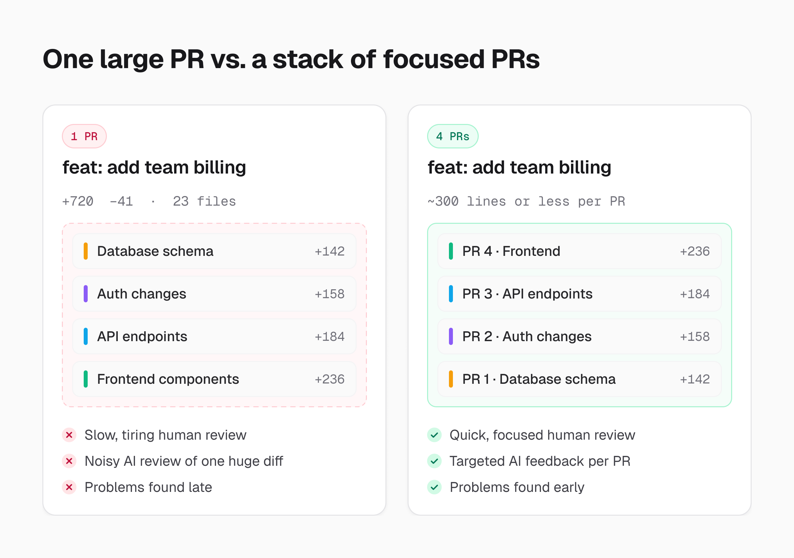
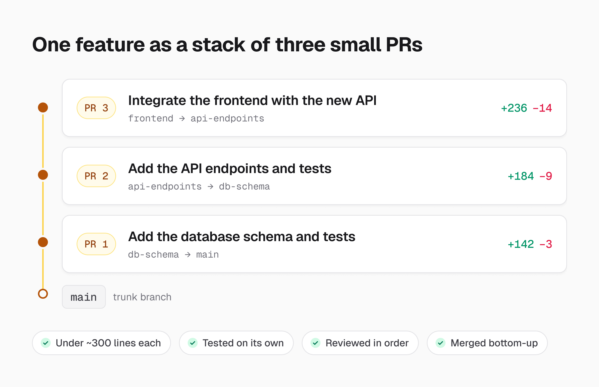
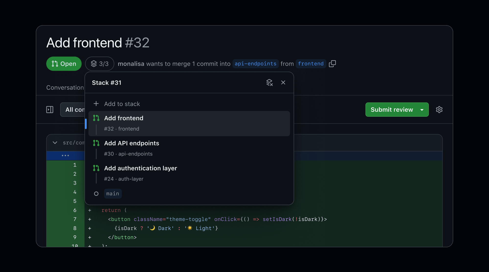
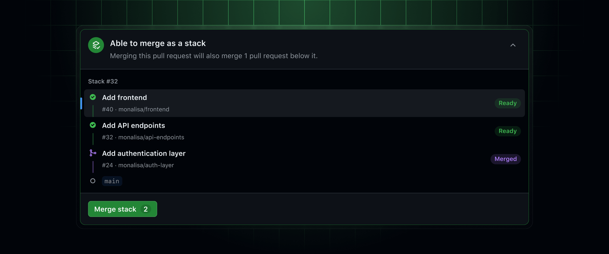
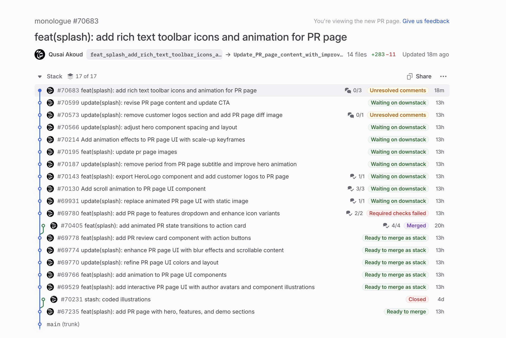
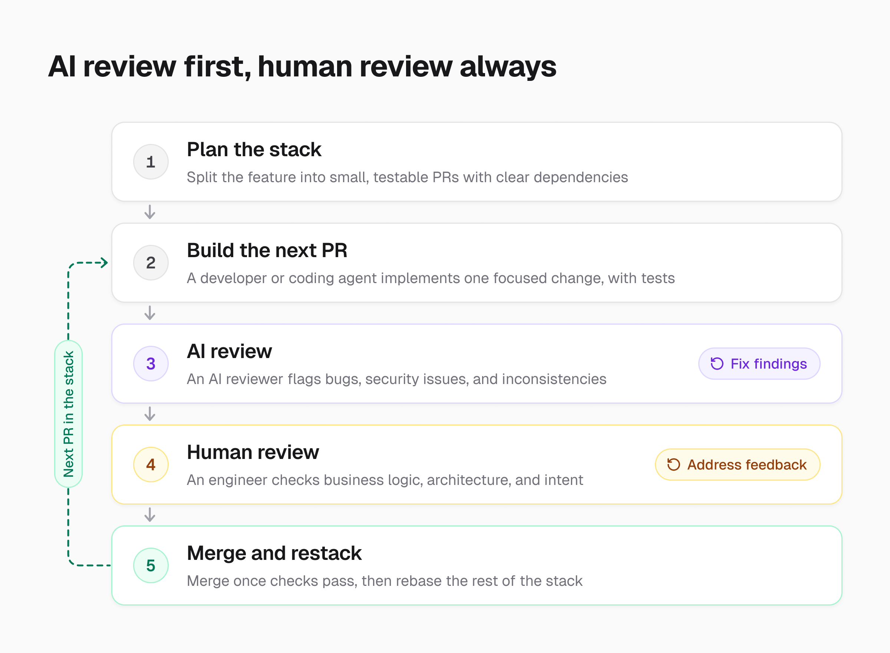

import Callout from "../../components/Callout.astro";
import Figure from "../../components/Figure.astro";

Over the past year, I've had conversations with several companies, engineers, and engineering managers. One topic that keeps coming up is whether traditional pull request (PR) reviews are still necessary in the age of AI-assisted development.

With AI coding tools becoming increasingly common, developers can generate and ship code faster than ever. Naturally, this has also increased the volume of code that needs to be reviewed.

I've heard concerns about there simply being too much code to review. Some have even suggested eliminating human reviews altogether and relying entirely on AI-powered code review tools. I've also seen companies I've worked with begin adopting these tools as part of their development workflows.

<Callout>I understand the reasoning, but I believe human code reviews are still essential.</Callout>

Don't get me wrong. I'm not against AI reviewing code. In fact, I think AI-powered reviewers are valuable. They can help identify potential bugs, flag security concerns, catch inconsistencies, and reduce the amount of repetitive work engineers have to do.

However, I don't believe they should completely replace human reviewers.

A human reviewer brings something important to the process through their understanding of the broader system, business requirements, architectural decisions, and the potential consequences of a change. These are areas where AI can provide useful assistance, but where human judgment and accountability still matter.

Recent security developments involving [PHP](https://www.php.net/archive/2026.php), [OpenCode](https://techcrunch.com/2026/10/19/hackers-hit-ai-coding-tool-opencode-running-up-charges-on-users-ai-accounts/), [Railway](https://blog.railway.com/p/preliminary-report-october-security-incident), and other projects are reminders of how important security and oversight remain in software development.

Of course, these incidents don't necessarily mean that code reviews were overlooked, nor would human reviews alone have prevented every issue. But they reinforce the importance of maintaining multiple layers of protection rather than depending entirely on a single tool or process.

## A Practical Approach to Human and AI Code Reviews

A few years ago, while working at [Central](https://centralhq.com/), I was introduced to the concept of [stacked pull requests](https://www.stacking.dev/). Around the same time, I became one of the early users of [Graphite](https://graphite.com/), a tool that made managing stacked PRs significantly easier.

The idea behind [stacked PRs](https://graphite.com/guides/stacked-diffs) is relatively simple. Instead of introducing an entire feature in one large pull request, you break the work into smaller, focused, and testable changes that build on top of one another.

This allows developers to continue working without waiting for every previous PR to be merged. It's particularly useful when multiple engineers are collaborating on the same feature or working on changes that depend on one another.

<Callout>With the rise of AI-assisted development, I believe this approach is more relevant than ever.</Callout>

AI has made writing code significantly faster, but that doesn't mean we should be generating massive pull requests that become difficult for humans to understand and review.

Instead, we can use AI to accelerate development while keeping changes small and manageable. I personally think aiming for PRs with fewer than 300 lines of meaningful changes is a reasonable guideline. It's not a strict rule, but it encourages developers to break down work into changes that are easier to understand, test, and review.

By combining stacked PRs with AI-assisted development and reviews, we can maintain a continuous development workflow without sacrificing human oversight.

## Why Stacked PRs Are Even More Important for Coding Agents

One benefit of stacked PRs that I think deserves more attention is how they can improve the way we plan and organize work for AI coding agents.

When we ask an AI agent to implement an entire feature in one go, we often end up with a large set of changes touching multiple parts of the codebase. Even when the implementation works, reviewing, testing, and understanding everything the agent has changed can become challenging.

Stacked PRs encourage a different approach.

Instead of giving an agent one large implementation task, we can structure the work into smaller, well-defined steps with clear dependencies and acceptance criteria.

For example, a feature that requires database changes, new API endpoints, and frontend updates could be divided into a stack of three PRs.

1. **PR 1** introduces the database schema changes and necessary tests.
2. **PR 2** implements the API endpoints and tests, building on the changes from PR 1.
3. **PR 3** integrates the frontend with the new API and adds the relevant tests.

Each PR has a specific responsibility, and the dependencies between changes are explicit.

This structure gives coding agents a clearer implementation plan and makes it easier to verify their work incrementally. It also helps us identify issues earlier instead of discovering them after an agent has generated hundreds or thousands of lines of code.

Of course, stacked PRs don't automatically make an AI agent better at planning. We still need to provide clear requirements, define the boundaries of each task, and ensure that changes are properly tested.

However, they give us a useful framework for organizing AI-generated code in a way that's easier for both humans and other AI agents to understand.

<Callout>The faster AI allows us to generate code, the more important it becomes to keep that code organized and reviewable.</Callout>

## Smaller PRs Also Make AI Code Reviews More Effective

Another important benefit of keeping PRs small is that it doesn't just make life easier for human reviewers. It can also improve the efficiency and effectiveness of AI-powered code review tools.

Today, we have tools like [GitHub Copilot Code Review](https://github.com/features/copilot/code-review), [Greptile](https://www.greptile.com/), and [CodeRabbit](https://www.coderabbit.ai/) that can automatically analyze pull requests, identify potential bugs, and suggest improvements.

These tools are becoming increasingly useful, but the amount of code and context they need to analyze still matters.

When an AI reviewer receives a pull request containing thousands of lines of changes across multiple files, it has a much larger set of modifications to reason about. There may be several unrelated concerns, architectural changes, and dependencies that need to be understood together.

This can make it more challenging to identify which changes are responsible for a potential issue. Depending on the tool and its configuration, larger reviews may also require more processing time and resources.

With smaller, focused PRs, the reviewer can concentrate on a more specific set of changes. This reduces unnecessary context and makes it easier to understand the intention behind each modification.

For example, reviewing a PR that only introduces a new API endpoint is generally more straightforward than reviewing one that simultaneously modifies the database schema, authentication logic, API endpoints, and frontend components.

<Callout>Smaller diffs give AI reviewers a more focused problem to analyze, which can lead to faster feedback and more relevant findings.</Callout>

This doesn't mean a smaller PR automatically guarantees a more accurate AI review. Some bugs only become apparent when examining how different components interact, so providing sufficient repository context remains important.

However, keeping each change focused can reduce noise and make it easier for both AI and human reviewers to identify potential issues.

It also creates a faster feedback loop. Instead of waiting for an entire feature to be implemented before reviewing it, we can have AI review each PR as it is created, address problems early, and continue building on top of those changes.

This is another reason I believe stacked PRs work particularly well with AI-assisted development. They allow coding agents to generate changes incrementally while AI reviewers validate those changes before they reach a human reviewer.

The result is a workflow where AI helps with both implementation and initial quality checks, while engineers remain responsible for the final review and approval.

## Even GitHub Is Embracing Stacked PRs

It's also interesting to see stacked PRs gaining broader adoption across the software engineering industry.

In July 2026, [GitHub introduced native support for stacked pull requests in public preview](https://github.blog/changelog/2026-07-30-stacked-pull-requests-are-now-in-public-preview/). The feature became [generally available on October 6, 2026](https://github.blog/changelog/2026-10-06-stacked-pull-requests-generally-available/).

GitHub now supports [creating, reviewing, rebasing, and merging stacked PRs](https://docs.github.com/en/pull-requests/how-tos/stacked-pull-requests), with CLI tooling and integrations designed to support coding agents.

<Figure>

  

  GitHub's stack navigator on a pull request page. Image: [GitHub Changelog](https://github.blog/changelog/2026-07-30-stacked-pull-requests-are-now-in-public-preview/).
</Figure>

<Figure>

  

  Merging a whole stack from GitHub's merge box. Image: [GitHub Changelog](https://github.blog/changelog/2026-10-06-stacked-pull-requests-generally-available/).
</Figure>

I think this is an important development because it makes the stacked PR workflow more accessible to engineering teams without requiring them to adopt an additional platform.

That said, GitHub's implementation is still relatively new. While it covers many of the core capabilities, it has some limitations, including the lack of support for cross-fork stacks and GitHub Desktop.

Graphite, on the other hand, offers a more comprehensive workflow with dedicated tooling for managing stacks, reviewing code, tracking PRs, and coordinating reviews across engineering teams.

<Figure>

  

  The stack view on Graphite's pull request page. Image: [Graphite docs](https://graphite.com/docs/pr-page-overview).
</Figure>

Having used Graphite early on, I appreciate how much easier it made working with stacked changes. I still think its broader set of tools offers advantages, particularly for teams that rely heavily on this development workflow.

Regardless of which tool teams choose, I think GitHub's adoption of stacked PRs reflects a broader shift toward smaller, more manageable changes, something that becomes increasingly valuable as AI-assisted development continues to grow.

## How I Would Structure the Workflow

1. **Break features into smaller, testable changes.** Whether the code is written by a developer or generated by an AI agent, each PR should have a clear purpose and ideally stay under 300 lines of meaningful changes.

2. **Plan the PR stack before implementation.** Encourage AI coding agents to identify dependencies, define the scope of each change, and organize their work into smaller PRs rather than generating one large implementation.

3. **Use stacked PRs to keep development moving.** Developers and coding agents can continue working on subsequent changes without waiting for every previous PR to be merged. Tools like [Graphite](https://graphite.com/) and [GitHub's native stacked PR support](https://docs.github.com/en/pull-requests/how-tos/stacked-pull-requests) help manage these dependencies.

4. **Let AI handle the initial review.** Tools like GitHub Copilot, Greptile, and CodeRabbit can review each small PR as it is created. Keeping diffs focused can help these tools provide more relevant feedback, identify potential bugs, and flag security concerns without having to analyze an unnecessarily large set of changes. Developers should address relevant findings before requesting human review.

5. **Keep a human in the review process.** Once the automated checks and AI review are complete, another engineer should review the PR. With smaller changes, the reviewer can focus on business logic, architecture, security implications, and whether the implementation actually solves the intended problem.

6. **Merge changes once they have passed the necessary checks.** Automated tests, AI-assisted reviews, and human approval should work together. As PRs are merged, the remaining stacked changes can be updated and reviewed against the latest code.

This approach allows engineering teams to benefit from AI without turning code review into a bottleneck.

It also helps maintain a balance between development speed and code quality, especially when multiple developers and AI agents are contributing changes simultaneously.

## Final Thoughts

<Callout>I believe AI should make code reviews more efficient rather than eliminate human involvement.</Callout>

We have an opportunity to rethink how we approach software development now that AI can handle much of the repetitive work. But moving faster shouldn't mean abandoning practices that help us maintain quality and accountability.

With smaller PRs, stacked changes, automated testing, and AI-assisted reviews, we can reduce the burden on human reviewers while keeping development moving.

I also believe stacked PRs will play an increasingly important role in how we work with AI coding agents. They encourage better planning, make changes easier to validate, and give AI code reviewers a more focused set of changes to analyze.

As we continue adopting AI throughout the software development lifecycle, we shouldn't lose sight of the engineering practices that help us build reliable, secure, and maintainable software.

<Callout>
  The goal shouldn't be to eliminate code reviews.
  It should be to make them better.
</Callout>
